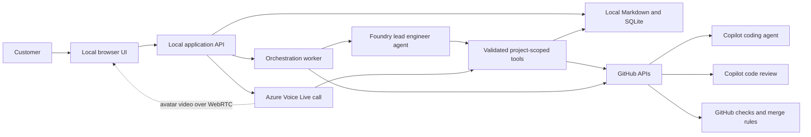

## 1. Product vision

At its core, Software Factory is a local project that, when run, opens a UI that helps the
user configure a new project. A Foundry-based lead engineer agent then coordinates the
backlog and assigns work to GitHub Copilot to get it done.

The customer describes a business idea and works with the lead engineer agent to shape it
into a business requirements document (BRD). The agent turns the BRD into GitHub issues on a
Projects board, assigns them to the GitHub Copilot coding agent, routes Copilot code review
findings back for fixes, and merges finished work into `main`. The customer follows progress
in Software Factory rather than in GitHub.

The lead engineer agent runs on Microsoft Foundry. GitHub Copilot is the coding agent and the
code reviewer. Software Factory coordinates their work; it does not introduce a second coding
agent or make the Foundry agent a code reviewer.

Status: Draft v0.2, MVP scope. Section 16 lists capabilities deferred beyond the MVP.

## 2. MVP scope

The MVP delivers one end-to-end loop:

1. Run Software Factory locally and open the browser UI.
2. Configure a project with an empty repository owned by the user's personal GitHub account, a
   classic PAT, and an initial BRD.
3. Refine the BRD in chat with the Foundry lead engineer agent.
4. The lead agent creates implementation tasks as GitHub issues on a personal Projects board.
5. When the customer tells the agent to proceed, it assigns ready tasks to Copilot in parallel.
6. Copilot code review examines each PR, and the lead agent routes findings back to Copilot
   through `@copilot` PR comments.
7. When the review is clean and checks pass, the lead agent approves the PR and merges it into `main`.
8. The customer sees progress in the UI.

## 3. Non-goals

* A hosted Software Factory service, shared database, or multi-user collaboration
* Work IQ, standup transcripts, Microsoft 365 integration, or email reporting
* Local code synthesis, local customer-repository execution, or a built-in code editor
* Independent code review by the Foundry lead agent; its PR approvals rely on Copilot review
  and required-check evidence
* GitHub Enterprise Server, GitHub Enterprise Cloud with data residency (GHE.com), or
  source-control providers other than GitHub.com
* Repositories or Projects boards owned by organizations
* Multiple repositories per project
* macOS or Linux support
* Runnable previews, deployment, or cloud resource provisioning
* Automatic bypass of GitHub branch protections, rulesets, or required approvals
* Guaranteed correctness or completion without any human intervention

Where GitHub or a business decision requires intervention, the application explains the
blocker rather than pretending that the workflow is fully autonomous.

## 4. Actors and responsibility boundaries

### 4.1 Customer

The customer describes business goals, answers questions, shapes the BRD, and tells the lead
agent when to start delivery. They use Software Factory rather than GitHub to understand
progress. They are not expected to write stories, inspect diffs, or review code.

### 4.2 Installation owner

The installation owner supplies Foundry configuration and connects each project's repository
and PAT. The owner's personal GitHub account is assumed to have access to Copilot cloud agent
and Copilot code review. Software Factory still checks these prerequisites and reports any that
are missing. The owner may also be the customer.

### 4.3 Foundry lead engineer agent

The lead agent owns requirements elicitation, planning, backlog management, delegation,
progress awareness, and customer communication. It may inspect repository structure, PR
descriptions, changed-file lists, check results, and Copilot findings for planning and
situational awareness.

It also performs the PR lifecycle actions that Copilot cannot perform for itself: moving
Copilot draft PRs to ready for review, requesting Copilot code review, approving a PR once
Copilot code review reports no blocking findings, and merging eligible PRs. Sections 7.4
and 7.5 define the policies for these actions.

When an attempt fails or a PR merges, the lead agent is notified through a delivery event. It
rewrites blocked tasks for fresh attempts and creates follow-up tasks (sections 7.6 and 7.7).

It must not author application code, form its own code-review verdicts, dismiss or override
Copilot findings, or invent test results. Its approval reflects Copilot's review outcome and
the required checks, not an independent judgment of the code.

### 4.4 GitHub Copilot coding agent

Copilot implements assigned issues in the connected repository, writes tests and developer
documentation, and opens PRs. It also implements fixes requested after review, failing
checks, or merge conflicts.

### 4.5 GitHub Copilot code reviewer

Copilot code review examines proposed changes and provides findings with High, Medium, or Low
severity. Each review includes an approval assessment in its overview comment. When the
repository enables Copilot approvals, Copilot can also submit an approving
review itself. A review request, a completed review, and an approving review are distinct events.

### 4.6 Local orchestration service

Application code, not the model alone, enforces project boundaries, merge gates, remediation
limits, and the parallel task limit. The model proposes and invokes typed tools; the service
validates every invocation.

## 5. User experience

### 5.1 Start the application

1. The owner installs dependencies and supplies the global Foundry settings in `.env`.
2. A single documented start command launches the local backend and UI.
3. The application opens a loopback browser URL. It is not a CLI product.
4. Existing projects load from the local data directory.

The application process hosts the orchestration worker, so closing the browser tab does not
stop it. Stopping the application stops local planning, polling, dispatch, and merging, but
work already assigned on GitHub continues.

### 5.2 Project list

The landing page lists existing projects and provides a New project button. Each project shows
its name, business summary, repository, delivery status, and whether it needs customer input
or owner action.

### 5.3 Create a project

The creation flow collects:

* Project name and a short business description
* An existing, empty repository URL owned by the user's personal GitHub account
* A classic PAT for that account with the `repo` and `project` scopes, entered through a
  masked control
* An initial BRD, supplied as Markdown, pasted text, or created through a guided conversation

The repository and the Projects board are both owned by the user's personal account. GitHub
Projects belong to an account and can be linked to a repository; they are not owned by the
repository itself.

Before provisioning anything, show a connection checklist covering repository access, the
PAT's scopes, Copilot cloud agent availability, and Copilot code review availability. A project
can be saved while a prerequisite is missing; execution stays blocked with a specific
explanation.

### 5.4 Project workspace

Opening a project exposes:

* Chat with the lead engineer agent, with durable conversation history
* A video call with the lead engineer, started from chat (section 5.6)
* The BRD as rendered Markdown with editing
* A backlog view showing tasks, board status, assigned Copilot work, PR and review state,
  and blockers
* Settings showing the repository, board link, PAT status, and parallel task limit, plus project
  deletion. Deleting requires typing the project name, removes only local data (database rows,
  documents, and the stored PAT), and explains that GitHub resources and running Copilot work
  remain

### 5.5 Start delivery

Delivery starts when the customer tells the lead agent to proceed in chat. The service records
that delivery has started, so it resumes after a restart. Starting delivery authorizes the
agent to assign tasks, move Copilot drafts to ready for review, request reviews, approve
PRs, and merge them into `main` without per-PR customer confirmation. Stopping the application
is the MVP's way to halt new dispatch and merges.

### 5.6 Video call with the lead engineer

A **Video call** button in chat opens a call inside the page. The lead engineer appears as an
Azure Voice Live standard video avatar, listens through the customer's microphone, and answers
aloud with live captions. The customer can also type lines into the call. Only the avatar sends
video; the customer's camera is not used.

* The call runs a Voice Live real-time model, `gpt-realtime` by default, with the lead engineer's
  instructions, project context (section 6.2), recent chat, and tools. Voice rules are added:
  short spoken sentences, no Markdown, and a spoken description of each change followed by the
  customer's explicit confirmation before `create_task`, `update_task`, `retry_task`,
  `write_document`, or `start_delivery`. During a call this applies to delivery events too.
* The backend relays microphone audio, typed lines, and the avatar's WebRTC offer and answer
  between the browser and Voice Live, and runs tool calls with the same validated project-scoped
  tools as chat. The avatar's video and voice stream from Azure directly to the browser.
* Each finished utterance is saved to the chat history and marked as from the call. Chat turns
  do not answer call messages, but later chat turns see them as history.
* While a call is open, delivery events (sections 7.6 and 7.7) go to the call instead of chat.
  Events that arrive as the call ends go to chat.
* One call per project at a time. The call keeps running when the customer switches tabs, and
  ends after 10 minutes without conversation, after 30 minutes, or when the app stops. The
  activity log records when each call starts and ends.

## 6. Requirements and project context

### 6.1 BRD

Every project has a local `BRD.md` containing:

* Business problem, intended users, and desired outcomes
* Product scope and explicit exclusions
* Functional requirements with stable identifiers
* Testable acceptance criteria
* Constraints, assumptions, and open questions

The agent asks focused questions rather than silently inventing customer intent. An open
question that affects a task blocks that task from dispatch. The customer and the agent can
both edit the BRD. The MVP keeps only the current version.

### 6.2 Project context

The agent maintains a `memory.md` file for decisions, customer preferences, terminology, and
its current understanding of the repository. It may record architecture notes in other project
Markdown documents. Before each agent turn, the service assembles bounded context from the
BRD, memory, recent conversation, and the latest GitHub snapshot.

The Foundry agent reads local documents through a project-scoped file-read tool that the local
application executes. Copilot never reads these files; the lead agent translates the relevant
requirements into self-contained GitHub issues. Credentials are never written to documents,
memory, or conversation history.

## 7. GitHub backlog and delivery

### 7.1 Set up the repository and board

An empty repository has no default branch from which Copilot can start. After the customer
confirms setup, Software Factory creates `main`, sets it as the default branch, and commits a
minimal README through GitHub APIs. Bootstrap does not upload the BRD or memory, and it is not
permission for the lead agent to write application code. Application scaffolding, tests, and
CI definitions are Copilot tasks.

Setup then creates a Projects board owned by the user's personal account, links it to the
repository, and configures a Status field with Todo, Ready, In progress, In review, Blocked,
and Done values. Persist the board ID, URL, and field identifiers locally so later runs
reconnect without board configuration. Re-running setup reuses the stored board instead of
creating another one.

Setup also creates a `main` ruleset that requires pull requests and status checks but no
approving reviews. Rulesets on private repositories depend on the account's GitHub plan. When
a ruleset is unavailable, the service's own merge gates still apply, and the checklist notes
that GitHub is not enforcing them.

### 7.2 Create tasks

The backlog is a flat list of implementation tasks, each a GitHub issue on the board. Every
task issue contains:

* Business outcome and linked BRD requirement identifiers
* Bounded implementation scope and explicit exclusions
* Acceptance criteria and expected verification evidence
* Relevant architecture decisions and repository context
* Dependencies on other task issues

Each issue is a self-contained implementation brief. Links to local files or requirement
identifiers alone are not sufficient instructions. Raw chats, memory, and credentials are not
copied into GitHub. The UI explains that issue content is visible to everyone who can access
the repository, and it warns explicitly before creating issues in a public repository.

Only implementation-sized tasks are created. Dependencies form an acyclic graph, and early
tasks establish scaffolding, tests, and CI so later tasks have checks to satisfy.

### 7.3 Dispatch tasks to Copilot

The service assigns ready task issues to Copilot through GitHub's issue assignment API. A task
is ready when its open questions are resolved and its dependencies have merged. The service
dispatches every ready task up to the project's parallel task limit.

Before assigning an issue, the service checks GitHub to confirm that the issue is not already
assigned to Copilot or linked to an open PR. This prevents duplicate work after a restart or
retry. A successful assignment means Copilot accepted the work, not that it finished.

Parallel PRs can conflict. When a PR becomes unmergeable because of conflicts with `main`, the
lead agent asks Copilot to resolve them through an `@copilot` PR comment. That request counts
toward the task's remediation limit.

### 7.4 Coordinate review and remediation

1. Detect the PR for the assigned task and its latest head SHA.
2. Wait until the Copilot coding session has finished.
3. Move the PR from draft to ready for review. Copilot cannot mark its own PRs ready.
4. Start any GitHub Actions workflow runs that GitHub held for approval on the current head.
5. Request Copilot code review for the current head, or observe a ruleset-triggered review.
6. Collect review findings and required-check results for the current head. Copilot rates each
   inline comment High, Medium, or Low through the comment's `copilot_code_review_severity`
   field. Low comments are deferred (section 7.6); High, Medium, and unrated comments block.
7. If blocking findings or failures exist, post a PR comment that mentions `@copilot` and
   restates each finding with its file, line, severity, and text.
8. Confirm that a remediation session started, using the agent tasks API or new commits. For
   20 minutes after the request, an unchanged head counts as "not started yet", so the same
   commit is never re-reviewed and a cycle is not wasted.
9. After that session finishes, return to step 4 for the new head.
10. Block the attempt when findings remain after the remediation limit (section 7.7).

Replies to individual Copilot review comments are not visible to Copilot and do not start a
coding session, so remediation always uses a PR-level `@copilot` comment. Copilot acts only on
comments from users with write access, which the owner's PAT provides. Request re-review after
each remediation session finishes rather than on every push, because each review is billed.

By default, GitHub holds workflow runs on Copilot PRs until a user with write access approves
them, and a held run produces no check runs. M0 showed that the REST approval endpoint refuses
these runs ("not from a fork pull request"), and that GitHub later marks them failed with zero
jobs. Re-running such a run from the owner's token starts it normally. Software Factory therefore
treats held and never-started runs as blocking, cancels or re-runs them up to three attempts,
and only then reports a failure. Turning off **Require approval for workflow runs** in the
repository's Copilot cloud agent settings avoids the delay. Either way, unreviewed Copilot code
runs in CI with access to repository secrets; an owner-confirmation guard for workflow-file
changes is deferred to section 16.

Each attempt gets at most three remediation cycles. Persistent failures, missing credentials,
and exhausted Copilot quota are surfaced explicitly.

### 7.5 Approve and merge

The service merges a PR into `main` only when every gate passes:

* Required checks have succeeded for the current head, and no workflow run is held for approval
* The latest Copilot review of the current head added no blocking findings
* An approval for the current head exists through one of the approval paths below
* All GitHub repository rules are satisfied
* The PR targets `main`, is not a draft, and is mergeable
* The head has not changed since the gates were evaluated

Merge with the expected head SHA so a late commit cannot slip in. Pending or unknown checks,
pending mergeability, and missing review evidence are not success.

A PR is approved through one of these paths, in order of preference:

1. Copilot submits an approving review for the current head, when Copilot approvals are
   enabled and count toward merge requirements.
2. The lead agent approves the PR when Copilot's latest completed review of the current head
   leaves no blocking findings, for example a review with no comments, only Low comments, or an
   overview stating that the PR is ready to approve ("LGTM" or equivalent).

The service does not need to know in advance whether Copilot approvals are available. It uses
path 1 when an approving Copilot review exists for the current head and otherwise applies
path 2. Lead-agent approval is a service-enforced gate, not model discretion: the service
verifies that the review's commit SHA matches the head, that the review added no blocking inline
comments, and that required checks passed. Copilot re-reviews the whole PR after each
remediation, so findings from earlier reviews that it does not repeat are treated as addressed.
An "LGTM" summary never overrides inline findings.

GitHub attributes Copilot's PRs to the user who assigned the issue, and that user cannot approve
their own PR. M0 confirmed that GitHub refuses the approving review, so lead-agent approval is
recorded locally and in a PR comment that links the Copilot review and check runs. Software
Factory does not add a second identity to work around this restriction, and it never weakens
protections or fabricates approval. If a repository rule requires an approval that neither path
can satisfy, the task is blocked with the owner action required.

A task is delivered only when its PR has merged into `main`. The agent reports what is
merged, in review, or blocked, and never equates an open PR or a finished Copilot session
with delivered work. Merged code is not deployed software.

### 7.6 Follow-up work from merged PRs

After every merge, the service posts a delivery event to the project chat and starts a lead
agent turn. The event carries the PR description, changed files, Copilot's review summary, and
any deferred Low findings. Text written by Copilot is marked as untrusted data.

* If deferred Low findings exist, the service itself creates one follow-up task that lists
  them, depends on the merged task, and is dispatched like any other task. Low findings on a
  follow-up task's own PR do not create another automatic follow-up, which prevents endless
  chains of minor fixes; the agent decides whether they matter.
* The agent creates further follow-up tasks only for required work within the approved BRD:
  work the PR reports as incomplete, or acceptance criteria it did not meet. It checks existing
  tasks to avoid duplicates and asks the customer before anything that expands scope.

### 7.7 Blocked tasks and fresh attempts

Each task gets up to three Copilot attempts, and each attempt gets up to three remediation
cycles. An attempt is blocked when findings remain after the remediation limit, Copilot opens
no PR within 60 minutes, the PR is closed without merging, a review cannot be requested, or
the issue is closed outside Software Factory.

When an attempt is blocked, the service records the reason, the unresolved findings, and the
full Copilot review history of the PR (every review summary and inline comment, plus failed
checks). It then posts a delivery event with that history and starts a lead agent turn.

* While attempts remain, the agent diagnoses why Copilot could not satisfy the review and calls
  `retry_task` with a rewritten brief and notes on what went wrong. A missing prerequisite may
  be added first as a separate task; the blocked task's own scope is never split into new
  tasks. Blockers a rewrite cannot fix, such as exhausted quota or missing permissions, are
  explained to the customer instead.
* `retry_task` starts fresh: it closes the abandoned PR with an explanation, rewrites the issue
  (adding a "Notes from previous attempts" section that accumulates across attempts), reopens
  it if needed, unassigns Copilot, and requeues the task. The next dispatch assigns Copilot
  again with instructions that name the attempt number and the abandoned PRs. Abandoned PRs
  never count as work in progress and are never picked up again as the task's PR.
* After the third failed attempt, the service refuses automatic retries. The task stays
  blocked, the project shows "Needs attention", and the workspace names the task and links to
  chat. The agent explains the blocker and proposes a way forward. A retry beyond the limit is
  accepted only in a turn where the customer has spoken since the agent's last reply; the
  service enforces this, not the model. Each customer-approved retry gets another full attempt.

Dependents of a blocked task wait until it merges. Merging a blocked task's PR manually is not
detected; recovery always goes through a retry.

Delivery events are stored as their own message role, shown in chat as collapsible notes, and
labeled for the model as not coming from the customer. Events that arrive while the agent is
busy are batched into the next turn, and no event is skipped.

### 7.8 Requirement changes

In the MVP, a BRD change affects only tasks that have not been assigned. The lead agent may
revise or reprioritize those tasks and create new ones. It does not edit issues already
assigned to Copilot; changes to in-flight or merged behavior become new tasks.

## 8. Persistence and synchronization

Sources of truth:

* Local documents define business intent.
* GitHub defines issue, board, PR, check, review, and merge state.
* SQLite stores conversations, project settings, task-to-issue mappings, and cached snapshots.

While the application runs, a backend worker polls GitHub for each active project. The worker
itself makes no model calls; it starts a lead agent turn only through delivery events, when a
task merges or an attempt is blocked (sections 7.6 and 7.7). Proposed default: poll every 60
seconds with rate-limit-aware backoff, plus a manual refresh.

While the application is stopped, Copilot sessions and CI continue on GitHub, but no dispatch,
remediation, or merge occurs. On restart, the worker refreshes each project's state from
GitHub before taking new actions. If GitHub is unavailable, local documents and conversations
remain readable and external actions wait.

## 9. Architecture

### 9.1 Component boundaries



### 9.2 Proposed stack

* Python backend with FastAPI, Pydantic settings, and the Microsoft Foundry SDK
* React and TypeScript browser UI
* Streaming chat and progress updates through server-sent events
* SQLite for local state and Markdown for project documents
* GitHub REST and GraphQL clients behind a single integration module
* A worker hosted in the backend process, with no external queue or scheduler

Development may run the backend and UI as separate processes behind a same-origin proxy, but a
single documented start command launches both.

### 9.3 Agent tools

Provide typed tools for:

* Reading and writing project documents
* Reading repository context
* Creating and updating task issues and board fields
* Reading a task's full record, including the Copilot review history of a failed attempt
* Retrying a blocked task with a rewritten brief (section 7.7)
* Assigning issues to Copilot
* Reading PRs, checks, and reviews
* Requesting Copilot review
* Posting `@copilot` remediation comments
* Marking PRs ready for review
* Approving and merging PRs

Bind the project, repository, board, and document directory in server-side execution context.
The model must not supply credentials, repository destinations, filesystem paths, shell
commands, or merge-policy overrides. Reuse Foundry agent versions when their model,
instructions, and tool schemas are unchanged.

## 10. Local data and configuration

### 10.1 Data directory

Use `%LOCALAPPDATA%\SoftwareFactory` as the per-user data directory, with
`SOFTWARE_FACTORY_HOME` as an override.

```text
SoftwareFactory\
  .env
  factory.db
  secrets\
  logs\
  projects\
    <project-id>\
      project.json
      BRD.md
      memory.md
      documents\
```

`project.json` contains non-secret settings such as the repository, board IDs, and parallel
task limit. Each project's PAT is stored in the `secrets\` directory, separate from
`project.json` and documents. PATs are never logged, never returned to the browser after entry,
and never passed to the model. Deleting a local project does not delete its GitHub repository,
board, issues, or PRs.

### 10.2 Foundry settings and authentication

The installation owner supplies Foundry configuration in `.env`:

```dotenv
AZURE_AI_PROJECT_ENDPOINT=
AZURE_AI_MODEL_DEPLOYMENT_NAME=
AZURE_TENANT_ID=
AZURE_TOKEN_CREDENTIALS=dev
SOFTWARE_FACTORY_AGENT_NAME=software-factory-lead
SOFTWARE_FACTORY_HOME=
LOG_LEVEL=INFO
VOICE_LIVE_ENDPOINT=
VOICE_LIVE_MODEL=gpt-realtime
VOICE_LIVE_VOICE=en-US-Ava:DragonHDLatestNeural
VOICE_LIVE_AVATAR=lisa-casual-sitting
```

Software Factory authenticates to Foundry only with Microsoft Entra ID; it does not support
API keys. The backend uses `DefaultAzureCredential`, which requests tokens for the
`https://ai.azure.com/.default` scope. `AZURE_TOKEN_CREDENTIALS=dev` limits the credential
chain to developer sign-ins such as the Azure CLI, Azure Developer CLI, and Visual Studio Code.
`AZURE_TENANT_ID` pins the tenant that hosts the Foundry project when the signed-in user
belongs to several tenants.

Before starting Software Factory, the owner signs in with `az login --tenant <tenant-id>`.
The signed-in user needs the **Foundry User** role on the Foundry project or resource, and
assigning that role requires Owner or User Access Administrator at that scope.

Video calls connect to Voice Live at `wss://<resource>/voice-live/realtime` on the Foundry
resource behind `AZURE_AI_PROJECT_ENDPOINT`, or on the resource in `VOICE_LIVE_ENDPOINT`, with
the same Entra credential. That resource must be in a region that supports avatars, and the
signed-in user needs the **Foundry User** role on the resource itself, not only on the project. `VOICE_LIVE_AVATAR` names
a standard video avatar as `<character>-<style>`. Voice Live hosts its real-time models as a
managed service, so calls need no model deployment beyond the lead engineer's chat model.

At startup, the service requests a token and calls the project endpoint. The UI shows Foundry
connection status with specific guidance: sign in again when no credential is available or a
token has expired, and request the Foundry User role when the call returns 403 Forbidden.
Credentials and tokens are never stored by Software Factory, sent to the browser, or passed to
the model.

Load the process environment first, then a working-directory `.env`, then the data-directory
`.env`. Publish a placeholder-only `.env.example`.

## 11. GitHub capability and permission contract

GitHub features, preview APIs, and account entitlements evolve. Setup validates each
capability rather than treating a valid PAT as proof that Copilot, Projects, review, and merge
are all available. Issue assignment to Copilot is in public preview, so the integration pins a
tested contract and returns actionable errors.

Each project uses a classic PAT for the owner's personal account with these scopes:

* `repo`, for issue assignment to Copilot, pull requests, checks, workflow-run approval,
  rulesets, and merging
* `project`, to create and update the personal Projects board

Fine-grained PATs cannot manage Projects boards owned by a user, so the MVP uses a classic PAT.
Projects can share one token. An expired or revoked token produces a specific blocker.

The owner's personal account is assumed to have access to Copilot cloud agent and Copilot code
review; setup confirms both. Reviews come from explicit requests through
`POST /repos/{owner}/{repo}/pulls/{pull_number}/copilot-code-review` or from a repository
ruleset. Handle a pending request, a denial caused by entitlement or quota, and a transient
failure separately.

Copilot reviews are comments by default. The repository's Copilot code review auto-approval
settings can let Copilot approvals count toward merge requirements.

Moving a draft PR to ready for review uses the GraphQL `markPullRequestReadyForReview`
mutation. `GET /repos/{owner}/{repo}/copilot/cloud-agent/configuration` reports whether
workflow runs require approval; no API changes that setting, and
`POST /repos/{owner}/{repo}/actions/runs/{run_id}/approve` refuses Copilot PR runs, but
`POST /repos/{owner}/{repo}/actions/runs/{run_id}/rerun` starts a held run that GitHub has
marked failed.

Copilot's PRs are attributed to the assigning user and use a `copilot/` head branch. The service
links a task to its PR through the issue's closing references and timeline, and uses the agent
tasks API (`GET /agents/repos/{owner}/{repo}/tasks`) to tell whether a Copilot session is still
working on the PR.

When the token cannot manage Projects boards, for example a fine-grained PAT on a personal
account, setup falls back to tracking task status with `sf:` issue labels and shows a warning.
Replacing the token with a classic PAT and re-running setup creates the board.

## 12. Safety basics

* Bind the local server to loopback only.
* Treat chat, documents, issues, repository files, and review comments as untrusted content
  that cannot override tool permissions or merge gates.
* Sanitize rendered Markdown.
* Confine document access to the active project's directory.
* Redact credentials in logs.
* Exclude destructive GitHub operations, deployments, and protection bypasses from the tool
  allowlist.
* Bound automation with the parallel task limit, the remediation limit, and retries with
  backoff. Persistent authorization failures or exhausted quota stop dispatch with a visible
  blocker.

## 13. Acceptance criteria

1. A single start command on Windows opens a UI with a project list and a New project flow.
2. A customer can create a project from an empty personal repository, a classic PAT, and a
   BRD. Missing prerequisites produce specific blockers without losing the draft project.
3. Setup creates `main` and a personal Projects board linked to the repository, and saves
   the board ID. Re-running setup or restarting does not create another board.
4. Chat history, the BRD, and project settings survive an application restart.
5. The lead agent reads the BRD through the project-scoped file tool and creates self-contained
   task issues on the board. No credentials or raw chat reach GitHub.
6. After the customer says to proceed, ready tasks are assigned to Copilot in parallel up to the
   limit, dependencies are respected, and a restart does not assign a task twice.
7. The lead agent moves Copilot drafts to ready for review, starts held workflow runs, and
   requests Copilot review without owner action. A held run never counts as passing.
8. Blocking Copilot findings and failed checks reach Copilot through `@copilot` PR comments.
   After three remediation cycles, the attempt is blocked and the lead agent receives the full
   Copilot review history.
9. A PR with no blocking Copilot findings and passing checks for its current head is approved
   and merged into `main` using the expected head SHA. Blocking findings, failing or pending
   checks, or a new commit prevent the merge. Low findings become one follow-up task.
10. A blocked attempt is retried automatically with a rewritten issue and a fresh Copilot
    session, up to three attempts. After that, the project shows "Needs attention", and the
    task can still be retried or supplemented with new tasks through chat once the customer
    agrees.
11. After each merge, the lead agent reviews the PR's output and creates follow-up tasks for
    required work within the approved BRD.
12. PAT expiration, missing permissions, Copilot quota exhaustion, and network loss preserve
    local data and show actionable errors.

Use automated tests against recorded GitHub responses for repeatability, plus an opt-in live
test against a disposable personal repository and board that covers the complete
issue-to-Copilot-to-review-to-merge path.

## 14. Milestones

### M0: Prove the GitHub integration

Use a disposable personal repository and Projects board to verify classic PAT scopes,
bootstrap to `main`, board creation, Copilot assignment, review requests, `@copilot`
remediation, draft-to-ready transitions, workflow-run approval, Copilot approval availability,
lead-agent approval under the requester restriction, and merging.

### M1: Local app and project setup

Deliver the start command, project list, creation flow with the connection checklist, Foundry
chat with durable history, and BRD editing.

### M2: Backlog and dispatch

Deliver board provisioning, task issue creation, parallel dispatch, polling, and the backlog view.

### M3: Review and merge loop

Deliver ready-for-review transitions, workflow-run approval, review requests, remediation,
conflict handling, and merge gates.

## 15. Decisions and open questions

Confirmed decisions:

* Use personal GitHub accounts. The repository and Projects board are owned by the user's
  personal account, which is assumed to have access to Copilot cloud agent and code review.
* The owner supplies an existing, empty personal repository.
* Use a classic PAT with the `repo` and `project` scopes. Setup still validates capabilities.
* Create and link the personal Projects board automatically.
* Use `main` as the default and integration branch. The delivery target is merged code in
  `main`, with no runnable preview.
* Merge automatically after approval and passing checks, without per-PR customer confirmation.
* Use Copilot approvals when present; otherwise the lead agent approves when Copilot's review
  of the current head leaves no blocking findings.
* Route Copilot findings to Copilot coding agent through `@copilot` PR comments.
* Defer Low-severity Copilot findings to an automatic follow-up task instead of blocking the
  merge.
* Give each task up to three fresh Copilot attempts with three remediation cycles each. The lead
  agent rewrites the issue between attempts; retries beyond the limit need the customer's
  agreement in chat. Blocked tasks are not split into replacement tasks.
* The lead agent reviews every merged PR and creates required follow-up tasks.
* The lead agent moves Copilot drafts to ready for review and starts held CI runs by re-running
  them, because GitHub's approval endpoint does not cover Copilot PR runs.
* Run multiple tasks per project in parallel.
* Offer in-page video calls with the lead engineer through Azure Voice Live with a standard
  avatar and the `gpt-realtime` model. Changes made on a call need spoken confirmation.
* Support Windows only.

Proposed defaults:

* Python with FastAPI, React with TypeScript, server-sent events, SQLite, and Markdown
* Up to three parallel tasks per project
* Poll GitHub every 60 seconds while the application runs
* A `main` ruleset that requires pull requests and status checks, without required approvals,
  where the account's plan supports rulesets for the repository

Open questions:

1. Can Copilot approvals be enabled for the personal repository? The workflow does not depend
   on the answer.
2. How should the agent support data science work that needs datasets, experiments, or compute
   beyond a GitHub coding environment?
3. What Windows packaging and installation experience should the first distribution provide?

## 16. Later

These capabilities are deferred beyond the MVP. Their key requirements are kept here for
future planning.

### 16.1 Start and pause controls

Add explicit Start and Pause controls. Start requires approval of the initial BRD and plan.
Pause stops new dispatches and merge requests after in-flight local actions finish, without
cancelling remote Copilot sessions. The UI distinguishes paused orchestration from work still
running on GitHub.

### 16.2 Epic, story, and task hierarchy

Organize the backlog into epics, user stories, and implementation tasks using native issue
hierarchy or explicit parent links. Decompose large epics and ambiguous stories before dispatch,
and roll up parent completion from acceptance criteria.

### 16.3 Restart reconciliation and action records

Persist each mutation's intent before the external call, with its outcome and external IDs.
Reconcile uncertain mutations before retrying them. Use per-project leases or OS locks so
multiple tabs or application instances cannot dispatch the same task. Keep sync checkpoints,
never present credential errors as empty success-shaped snapshots, and never label a cached
snapshot as live.

### 16.4 Windows Credential Manager for PATs

Store PATs in Windows Credential Manager through the OS keyring, keeping only credential
references in project configuration.

### 16.5 BRD revisions and approval

Make document writes atomic and versioned. Keep proposed BRD changes as drafts until approved,
record the exact approved revision, and mark derived documents stale until reconciled.
Concurrent UI edits produce a visible conflict. Each dispatched issue records its source BRD
revision and issue-body hash.

### 16.6 Structured memory with provenance

Each memory entry records its source, date, and status as a confirmed fact, approved decision,
tentative interpretation, or superseded statement. Inferences never silently become
requirements. The customer can inspect and correct memory, and older conversations are
summarized without deleting their history.

### 16.7 Architecture and delivery plan documents

Maintain `architecture.md` and `delivery-plan.md` covering components, data flows, interfaces,
security boundaries, risks, validation strategy, and milestones. Decisions record rationale and
alternatives, and those with material cost, privacy, or scope consequences require customer or
owner approval.

### 16.8 Requirement-change impact assessment

An approved change creates a new baseline and an impact assessment covering pending tasks,
dispatched work, open PRs, and delivered capabilities. Active work is explicitly continued,
cancelled, or superseded, and superseded issues link to the change and replacement work.
Define which business changes require renewed approval.

### 16.9 Owner confirmation for workflow-file changes

Hold PRs that modify `.github/workflows/**` or other owner-designated sensitive paths for owner
confirmation before merging, since CI on Copilot PRs runs without per-run approval.

### 16.10 Activity and audit history

Record an auditable entry for every external mutation and show an activity view with actions,
failures, approvals, and resource links. Progress summaries carry last-sync timestamps and
evidence links. Show dispatch and remediation counts and available service-usage information.

### 16.11 Local API hardening

Protect local APIs against cross-origin requests, cross-site request forgery, and other browser
origins with an installation-session authorization mechanism. Loopback binding alone is not
authentication.

## 17. GitHub integration references

Checked on 2026-11-16. Revalidate during M0 because preview contracts and policies may change.

* [Using Copilot cloud agent via the API](https://docs.github.com/en/copilot/how-tos/use-copilot-agents/cloud-agent/use-cloud-agent-via-the-api)
* [Asking Copilot to make changes to an existing pull request](https://docs.github.com/copilot/how-tos/use-copilot-agents/cloud-agent/make-changes-to-an-existing-pr)
* [Using GitHub Copilot code review](https://docs.github.com/en/copilot/how-tos/use-copilot-agents/use-code-review)
* [Configuring code review by GitHub Copilot](https://docs.github.com/en/copilot/how-tos/copilot-on-github/set-up-copilot/configure-code-review)
* [REST API endpoints for Copilot code review](https://docs.github.com/en/rest/pulls/copilot-code-review)
* [Configuring settings for GitHub Copilot in the cloud](https://docs.github.com/en/copilot/how-tos/use-copilot-agents/cloud-agent/configuring-agent-settings)
* [REST API endpoints for Copilot cloud agent repository management](https://docs.github.com/en/rest/copilot/copilot-cloud-agent-management)
* [Using the API to manage Projects](https://docs.github.com/en/issues/planning-and-tracking-with-projects/automating-your-project/using-the-api-to-manage-projects)
* [Copilot cloud agent risks and mitigations](https://docs.github.com/en/copilot/concepts/agents/cloud-agent/risks-and-mitigations)
